# Wildfire Prediction in Castilla y León

Classification model that estimates the probability of a wildfire at a specific point and day in Castilla y León. It combines the historical fire record (2006-2023) with daily weather data, vegetation maps, terrain and population, and turns its predictions into daily wildfire risk maps of the whole region.

| | Temporal ROC-AUC | Spatial ROC-AUC |
| --- | :---: | :---: |
| **Best model (tuned LightGBM)** | **0.803** | **0.767** |

- **Temporal**: ability to predict fires in future years the model has not seen.
- **Spatial**: ability to predict fires in areas of the map the model has not seen.

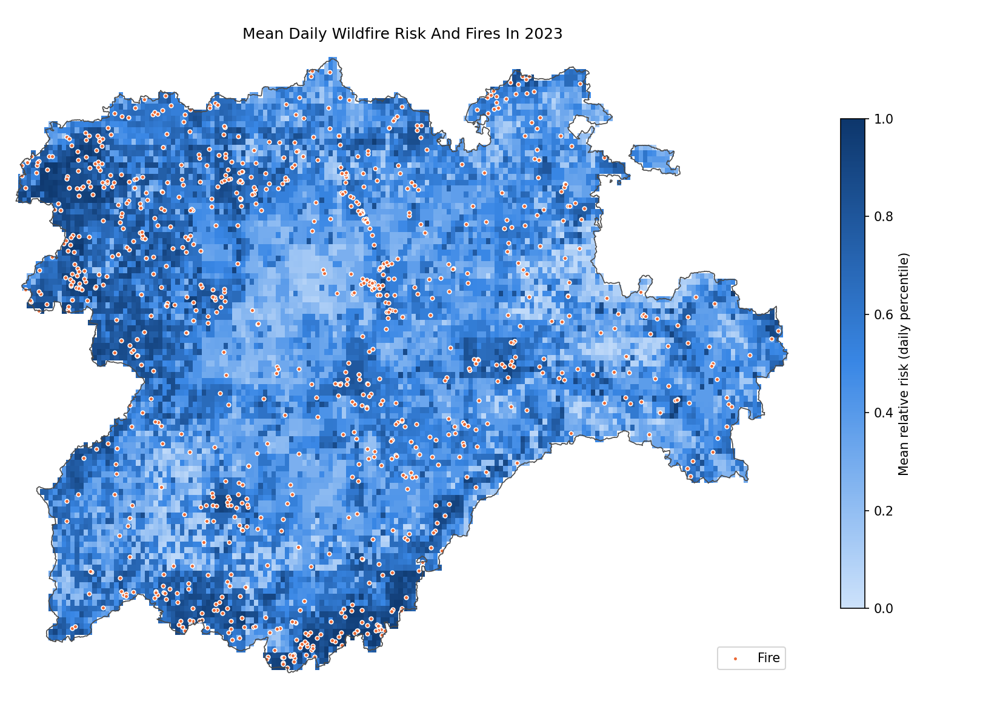

---

## Contents

1. [Data sources](#data-sources)
2. [Dataset construction](#dataset-construction)
3. [Validation strategy](#validation-strategy)
4. [Model comparison](#model-comparison)
5. [Best model tuning](#best-model-tuning)
6. [Risk maps](#risk-maps)
7. [Conclusions](#conclusions)
8. [Repository structure](#repository-structure)
9. [Requirements](#requirements)

---

## Data sources

| Source | Origin | Format | Content |
| --- | --- | --- | --- |
| Fire records | [Spanish Ministry of Agriculture, Fisheries and Food (MAPA)](https://servicio.mapa.gob.es/incendios/Search/Publico) | `.xlsx` | Detection date and UTM coordinates of every fire and small fire (2006-2023). |
| Weather | [E-OBS v33.0e, Copernicus Climate Data Store](https://cds.climate.copernicus.eu/datasets/insitu-gridded-observations-europe?tab=overview) | `.nc` | Daily 0.1° grid with mean, minimum and maximum temperature, precipitation, relative humidity, solar radiation, wind speed and sea level pressure. |
| Terrain | [E-OBS v33.0e, Copernicus Climate Data Store](https://cds.climate.copernicus.eu/datasets/insitu-gridded-observations-europe?tab=overview) | `.nc` | Land elevation on the same 0.1° grid. |
| Vegetation | [Spanish Forest Map (MITECO)](https://www.miteco.gob.es/es/cartografia-y-sig/ide/descargas/biodiversidad/mfe.html) | `.shp` | Forest polygons with species, occupation, development stage, cover, forest type and fuel model. |
| Population | [Municipal census (INE)](https://www.ine.es/dynt3/inebase/es/index.htm?padre=525) | `.csv` | Yearly population of every municipality in the nine provinces. |
| Municipal boundaries | [CNIG Download Centre (IGN)](https://centrodedescargas.cnig.es) | `.shp` | Municipal boundaries, used to assign each point to its municipality. |

---

## Dataset construction

The whole process is in [`preprocessing.ipynb`](preprocessing.ipynb) and produces `dataset.csv`.

1. **Fire cleaning**: the records use two coordinate systems (ED50 for the old ones and ETRS89 for the new ones) in UTM zones 29, 30 and 31. All of them are converted to WGS84 (EPSG:4326). Records without coordinates, with obvious errors or outside the region are dropped.
2. **Weather variables**: besides the value of the day, rolling windows summarize the state of the land in the previous days.
   - Accumulated precipitation over 7, 30 and 90 days.
   - Mean humidity over 7 and 30 days.
   - Temperature and wind maximums and minimums over different windows.
   - Accumulated radiation over 7 and 30 days.
   - Derived indices: wind/humidity ratio, fanning index (wind × dryness × temperature), 30-day moisture deficit and consecutive dry days.
   - Cyclical encoding of the day of the year (sine and cosine).
3. **Terrain**: slope and south orientation are computed from the elevation.
4. **Vegetation**: species are turned into a fuel risk index (from 0 to 5), weighted by the occupation of each species in the polygon. Development stage and stand distribution are encoded as ordinal values, and forest type with one-hot encoding.
5. **Population**: each point is assigned to its municipality and joined with that year's census population.
6. **Negative sampling**: for every fire, two points without fire are generated, always inside forest areas:
   - one with **the same date** as the fire, so the model learns to tell places apart;
   - another one with **a random date**, so the model learns to tell days apart.

The result has **82,537 records** (27,468 fires, 33%) and **48 variables**. The number of fires changes a lot between years, with peaks in 2009, 2011, 2012 and 2017 (analysis in [`dataset_analysis.ipynb`](dataset_analysis.ipynb)).

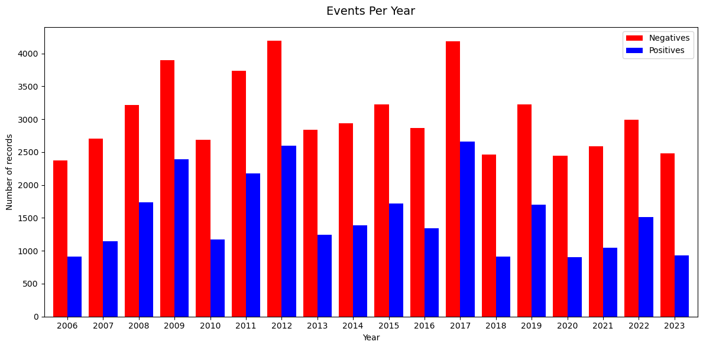

---

## Validation strategy

A random split would give over-optimistic results: consecutive days and nearby points share almost the same weather. That is why two independent tests are used.

- **Temporal validation**: for each year between 2015 and 2023, the model is trained only with earlier data and evaluated on that year. A **90-day gap**, the longest rolling window, separates training and test, so no test variable is computed with training days.
- **Spatial validation**: the map is divided into 0.3° blocks (about 30 km) that are distributed into **5 groups**. The model is evaluated on each group after training with the rest, so it always predicts areas it has not seen.

The main metric is **ROC-AUC**: 0.5 means predicting at random and 1 means a perfect model.

---

## Model comparison

[`models.ipynb`](models.ipynb) evaluates 12 models from 8 different families with both tests.

| Family | Models |
| --- | --- |
| Baseline | Dummy (always predicts the fire proportion) |
| Linear | Logistic Regression |
| Probabilistic | Naive Bayes |
| Instance based | K-Nearest Neighbors |
| Single tree | Decision Tree |
| Bagging | Random Forest, Extra Trees |
| Boosting | HistGradientBoosting, XGBoost, LightGBM, CatBoost |
| Neural network | Multilayer Perceptron |

### Results

| Model | Temporal ROC-AUC | Spatial ROC-AUC | Temporal PR-AUC | Spatial PR-AUC | Training time |
| --- | :---: | :---: | :---: | :---: | :---: |
| **LightGBM** | **0.797** | **0.767** | **0.651** | **0.616** | 5 s |
| XGBoost | 0.796 | 0.764 | 0.650 | 0.615 | 24 s |
| CatBoost | 0.795 | 0.766 | 0.648 | 0.615 | 31 s |
| HistGradientBoosting | 0.791 | 0.761 | 0.641 | 0.609 | 10 s |
| Random Forest | 0.773 | 0.765 | 0.616 | 0.612 | 21 s |
| Extra Trees | 0.764 | 0.760 | 0.601 | 0.605 | 9 s |
| MLP | 0.764 | 0.757 | 0.599 | 0.602 | 12 s |
| KNN | 0.735 | 0.730 | 0.562 | 0.564 | < 1 s |
| Decision Tree | 0.721 | 0.696 | 0.539 | 0.515 | 2 s |
| Logistic Regression | 0.715 | 0.711 | 0.526 | 0.536 | 2 s |
| Naive Bayes | 0.659 | 0.653 | 0.450 | 0.460 | < 1 s |
| Dummy | 0.500 | 0.500 | 0.315 | 0.332 | - |

**Boosting** models are the best in both tests. The differences between them are very small, and below them there are clear steps between families.

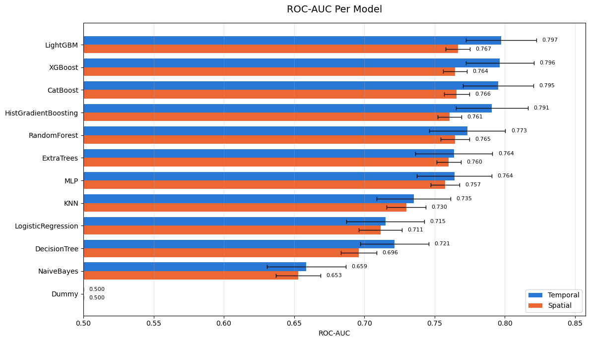

The order of the families holds in every year and every area. Some years are harder for every model (2017 and 2022), which points to a difficulty in the data and not in a specific model.

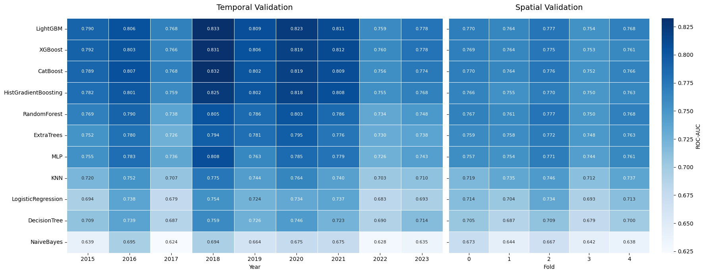

ROC curves of the best model of each family:

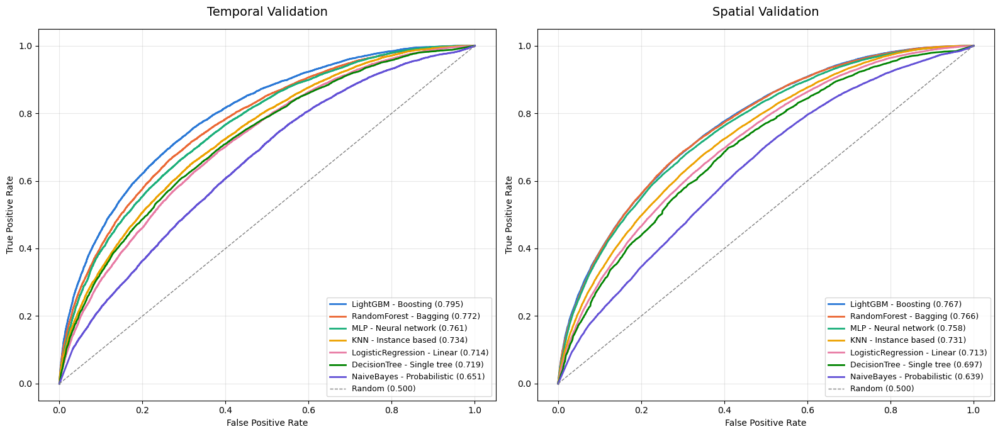

The best models perform slightly worse in new areas than in new years: they fall below the diagonal.

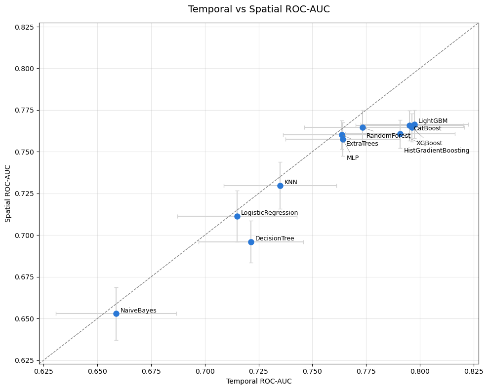

LightGBM is the best model and also one of the fastest:

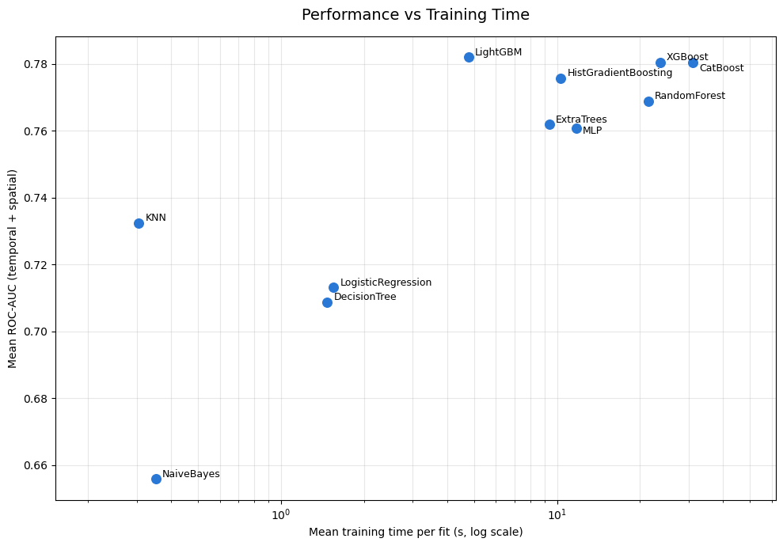

---

## Best model tuning

[`bestmodel.ipynb`](bestmodel.ipynb) tunes the LightGBM hyperparameters with **Optuna** (60 combinations). To get an honest score:

- the tuning only uses **data before 2015**, with its own temporal (2012-2014) and spatial validation;
- the final evaluation uses **data from 2015 to 2023**, which the tuning never sees.

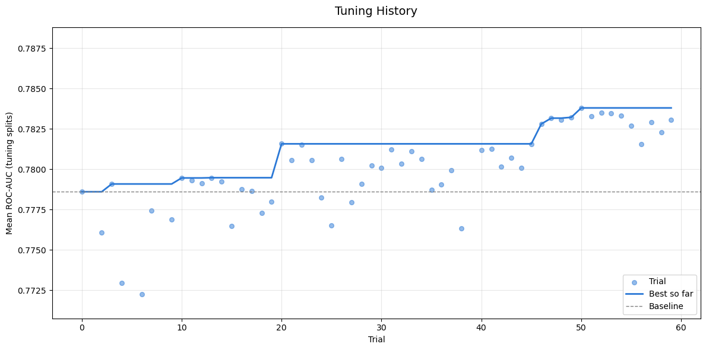

| Hyperparameter | Original | Tuned |
| --- | :---: | :---: |
| Number of trees | 1000 | 1700 |
| Learning rate | 0.02 | 0.005 |
| Leaves per tree | 63 | 213 |
| Minimum samples per leaf | 20 | 17 |
| Rows per tree | 80% | 98% |
| Variables per tree | 70% | 30% |

The decision threshold is also chosen with the tuning data: the one that maximizes F1 is **0.369**, instead of the default 0.5.

| | Temporal ROC-AUC | Spatial ROC-AUC | Temporal PR-AUC | Spatial PR-AUC | Temporal F1 | Spatial F1 |
| --- | :---: | :---: | :---: | :---: | :---: | :---: |
| Original LightGBM | 0.797 | 0.763 | 0.651 | 0.603 | 0.612 | 0.575 |
| **Tuned LightGBM** | **0.803** | **0.767** | **0.659** | **0.613** | **0.613** | **0.590** |

> The spatial test only evaluates data from 2015 onwards. That is why the original model scores 0.763 here instead of the 0.767 of the comparison.

The tuned model beats the original one in all 9 years and all 5 areas:

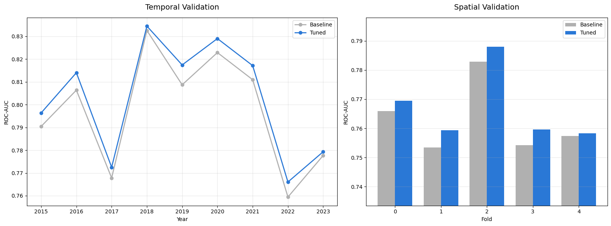

Most important variables of the final model:

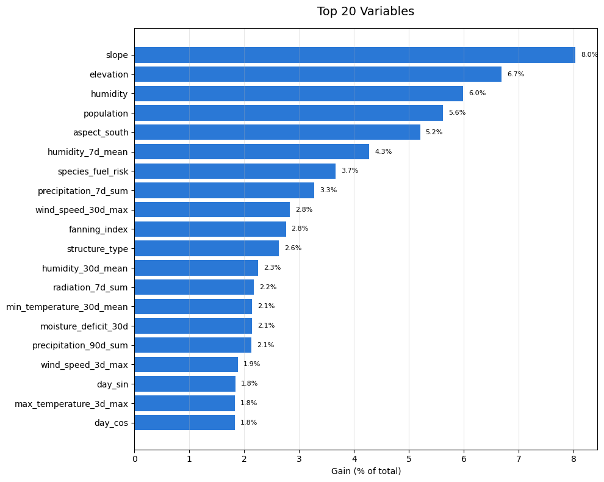

The final model, trained with all the data, is saved in `best_model.txt` and can be loaded with `lightgbm.Booster(model_file="best_model.txt")`.

---

## Risk maps

[`heatmap.ipynb`](heatmap.ipynb) uses the model to draw daily wildfire risk maps of 2023, the last year of the dataset, and checks them against the real fires.

1. **Model**: the tuned LightGBM is trained again only with data before 2023 (with the 90-day gap), so 2023 is never seen during training. It reaches a ROC-AUC of **0.780** on the 2023 records.
2. **Grid**: the region is covered with a regular grid of points every 0.03° (about 3 km), **11,350 points** inside the Forest Map. Each point gets the same static variables as the dataset: vegetation, population and terrain.
3. **Weather**: the weather variables are computed for every day of 2023, with one extra year before so the rolling windows and dry days are complete from January.
4. **Daily risk**: every point is scored on every day (about 4 million predictions), with the weather of its nearest 0.1° cell.
5. **Relative risk**: the model is trained with a 33% fire rate, so its outputs rank the risk but are not real probabilities. Each day, the scores are turned into percentiles: 1 is the riskiest point of the region that day and 0 the safest.

### Evaluation

Each of the **928 fires** of 2023 is placed in its nearest grid point and checked against the risk of that same day. If the map were random, the riskiest 10% of the region would hold 10% of the fires.

Two maps are compared:

- **Daily map**: the risk of the day of each fire.
- **Static map**: the mean risk of each point over the year, the same every day. It only shows *where* fires usually happen.

| Riskiest share of the region | Random | Static map | Daily map |
| :---: | :---: | :---: | :---: |
| 10% | 10% | 28% | **33%** |
| 20% | 20% | 43% | **50%** |

The riskiest 10% of the region holds a third of the fires, 3.3 times more than a random map. Most of the gain already comes from the location (static map), and the weather of each day adds about 5-7 points more.

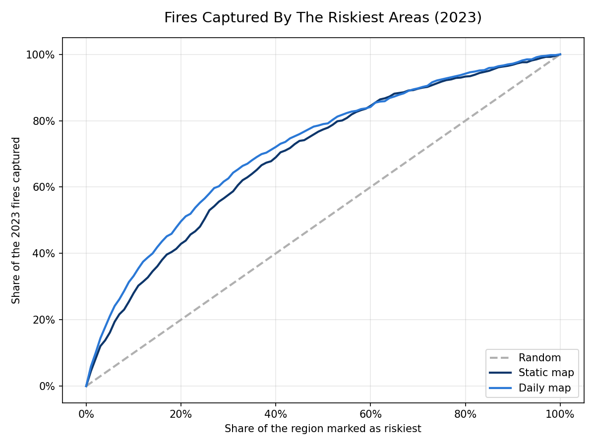

### Maps

Light points are the safest of the region and dark points the riskiest. The fires are drawn in orange.

The mean map of the year (at the top of this document) shows the areas with the highest risk: the west of León and Zamora and the southern mountains of Salamanca and Ávila. The daily maps show how the risk moves with the weather. The 4 days with the most fires of 2023:

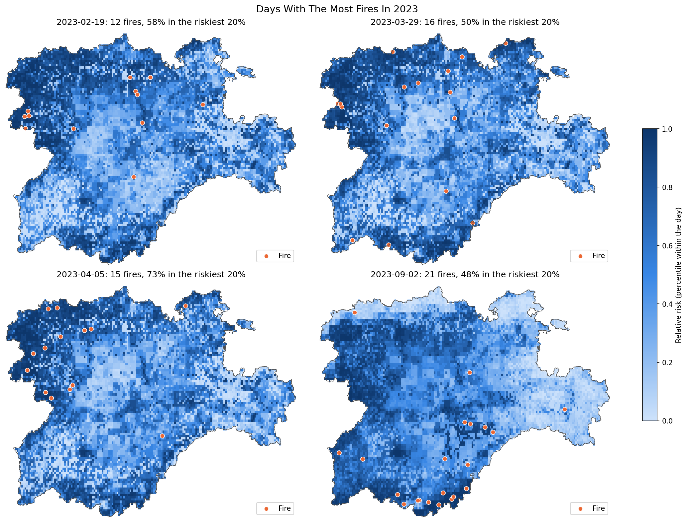

---

## Conclusions

- **Wildfire risk can be predicted with good discrimination**: the final model reaches a ROC-AUC of 0.80 in future years and 0.77 in new areas. These scores measure how well the model separates fires from the sampled negatives. The predicted probabilities assume a fire rate of 33%, so they are not real-world probabilities.
- **Tree ensembles fit this data best**: the dataset is tabular and heterogeneous, with continuous weather variables, ordinal and one-hot vegetation codes, very different scales and many correlated variables (such as the rolling windows). Tree-based models handle all of this by design: they split on thresholds, are not affected by scale, tolerate redundant variables and capture interactions without having to define them. The MLP, which is sensitive to these issues, only reaches the level of bagging.
- **Boosting is the best family**: boosting builds each tree to correct the errors of the previous ones, while bagging averages independent trees. Boosting beats bagging by 0.02-0.03 AUC in the temporal test. LightGBM, XGBoost, CatBoost and HistGradientBoosting are practically tied, with differences smaller than the variation between years. LightGBM is the best choice because it trains 5 to 6 times faster than XGBoost or CatBoost.
- **Non-linear effects and interactions matter**: Logistic Regression scores 0.06-0.08 AUC below boosting, so the risk is not well explained by adding up a linear effect of each variable. Thresholds (such as a long dry period) and combinations (heat, wind and dryness at the same time) are key.
- **Generalizing to new areas is harder than to new years, and the limit is the data**: the best models lose about 0.03 AUC in the spatial test. Moreover, in the spatial test the seven best models are within 0.01 AUC of each other, while in the temporal test they spread over 0.03. A more complex model helps to predict new years, but not new areas.
- **Terrain and population weigh more than weather**: slope, elevation, population and orientation are the most important variables. This may partly come from how the negatives are generated (random points inside forest areas). In the temporal test the model has already seen the same locations, so these static variables can act as a memory of where fires are usually recorded, which would also explain the gap with the spatial test.
- **The risk maps are useful, mostly because of the location**: the riskiest 10% of the region holds 33% of the 2023 fires. A static map of the mean risk already holds 28%, so the weather of each day adds a smaller part, which agrees with the variable importance.
- **Hyperparameter tuning adds little**: around +0.005 AUC. The improvement is consistent, but it shows the model is close to its limit with the current variables. The next improvements should come from the data, not from the model.

## Next steps

- [ ] Review the negative sampling to avoid bias.
- [ ] Compute slope and orientation from a high-resolution elevation model (such as the IGN MDT25) instead of the 0.1° grid.
- [ ] Add new variables, such as distance to roads and towns, land use or satellite vegetation indices.
- [ ] Reduce the redundancy between rolling-window variables: PCA for the linear, distance-based and neural models, and SHAP-based feature selection for boosting.
- [ ] Calibrate the probabilities to the real fire rate, so the maps show real probabilities instead of relative risk.

---

## Repository structure

```
├── data/                     # Original data (not included)
├── images/                   # Plots used in this document
├── preprocessing.ipynb       # Cleaning, merging of the sources and creation of dataset.csv
├── dataset_analysis.ipynb    # Exploratory analysis of the dataset
├── models.ipynb              # Model comparison with temporal and spatial validation
├── bestmodel.ipynb           # LightGBM tuning and final evaluation
├── heatmap.ipynb             # Daily wildfire risk maps of 2023
├── dataset.csv               # Final dataset
└── best_model.txt            # Final trained model
```

The notebooks run in this order: `preprocessing` → `dataset_analysis` → `models` → `bestmodel` → `heatmap`.

---

## Requirements

- Python 3.12
- Data: `pandas`, `numpy`, `geopandas`, `xarray`, `netCDF4`, `pyproj`, `scipy`
- Models: `scikit-learn`, `xgboost`, `lightgbm`, `catboost`, `optuna`
- Plots: `matplotlib`, `seaborn`
